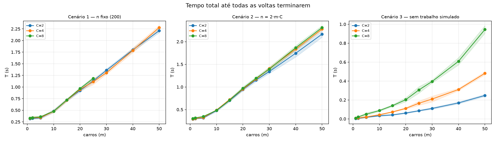
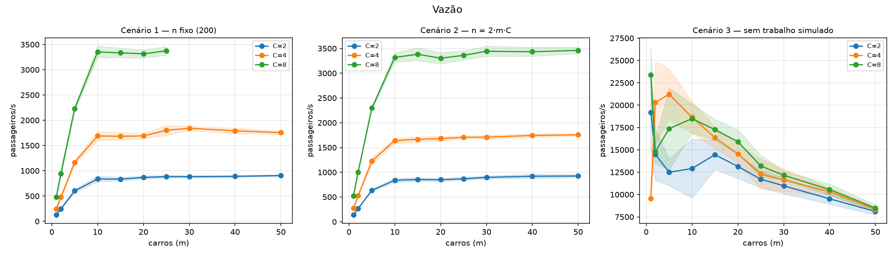
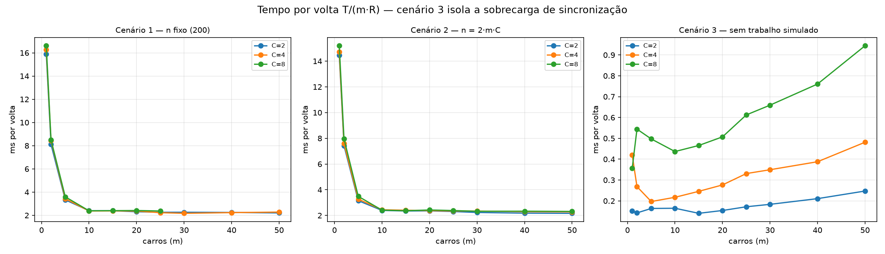
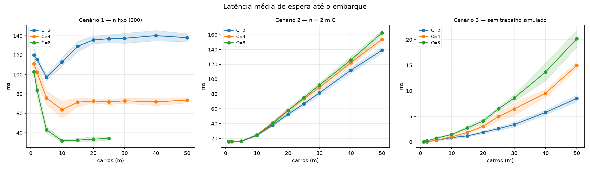

# Relatório Final — Problema da Montanha-Russa

**Trabalho Prático 2 — Sistemas Operacionais**
**Data:** 26 de novembro de 2026

## Resumo

Este relatório apresenta o projeto, a implementação, a bateria de testes e a avaliação experimental de uma solução para o Problema da Montanha-Russa, tanto no caso de um carro quanto no caso com múltiplos carros. A solução usa semáforos contadores sobre `SemaphoreSlim` e uma corrente de entrega que preserva a ordem de desembarque sem impedir que vários carros percorram a pista simultaneamente. Nove casos de teste com invariantes instrumentados passaram. Foram executadas 2.610 medições (87 configurações × 30 repetições) em três cenários de carga. Os resultados mostram que a vazão cresce até aproximadamente 10 carros e então satura, que a latência cresce com a disputa por vagas de embarque e que a sobrecarga de sincronização, isolada no cenário sem trabalho simulado, tem comportamento em U em função do número de carros.

---

## 1. Objetivo e requisitos

O problema, devido a Andrews [1] e atribuído à dissertação de Herman [2], modela `n` threads de passageiros e uma ou mais threads de carro. Um carro comporta `C` passageiros (`C < n`) e só pode circular cheio. As restrições do caso com um carro são:

1. os passageiros invocam `board` e `unboard`;
2. o carro invoca `load`, `run` e `unload`;
3. nenhum passageiro embarca antes do `load`;
4. o carro não parte antes de `C` embarques;
5. nenhum passageiro desembarca antes do `unload`.

No caso com `m` carros, acrescentam-se quatro restrições: apenas um carro embarca por vez; vários carros podem estar na pista; nenhum carro ultrapassa outro, logo o desembarque segue a ordem de embarque; todos os passageiros de uma carga desembarcam antes de qualquer passageiro das cargas seguintes. Cada carro possui um identificador local `i` entre `0` e `m-1`.

O objetivo deste trabalho é implementar as duas versões, verificar as restrições por instrumentação e avaliar tempo, vazão, latência, speedup, eficiência, sobrecarga e uso de CPU variando `m` de 1 a 50.

---

## 2. Decisões de projeto

### 2.1 Modelo de concorrência

Cada carro e cada passageiro é uma `Thread` nativa do .NET (`System.Threading.Thread`), não uma tarefa assíncrona. A opção preserva o modelo do enunciado — threads que bloqueiam em semáforos — e evita que a medição de latência seja distorcida pelo escalonador do pool de threads. O custo é a criação de até 850 threads por repetição no maior cenário (`m=50`, `C=8`), o que é aceitável e, de fato, aparece na análise da sobrecarga.

### 2.2 Primitivas de sincronização

Adotou-se um wrapper mínimo (`Semaphore.cs`) com operações `wait()` e `signal()` sobre `SemaphoreSlim`. Isso mantém a forma do pseudocódigo clássico (P/V), permite espera bloqueante eficiente — o semáforo libera o processador enquanto o thread espera — e dispensa `Monitor.Wait/Pulse` manual, cuja lógica de condição é mais fácil de errar.

### 2.3 Atribuição de passageiros

Cada passageiro é fixado estaticamente ao carro `p mod m`. Assim, um passageiro nunca precisa descobrir qual carro está carregando, e não é necessário um despachante compartilhado. A condição `n ≥ m·C` garante que todo carro tenha passageiros suficientes; combinações que a violam (por exemplo, `C=8`, `m>25` com `n=200`) são descartadas na matriz. A alternativa dinâmica — fila única de passageiros — foi preterida por acrescentar sincronização sem alterar as garantias pedidas.

### 2.4 Ordem de desembarque

Uma ficha compartilhada adquirida no início do `unload` **não** resolve o problema: um carro que embarcou depois pode chegar primeiro ao `wait` e consumir a ficha, invertendo a ordem. Adquirir a ficha antes do `run` também não serve, pois impediria carros simultâneos na pista.

A solução adotada captura a ordem no momento do embarque, enquanto o semáforo `carregando` ainda está retido. Cada carro anexa à cauda de uma fila um semáforo `done` **novo** e guarda o `done` do carro imediatamente anterior. Após `run()`, ele espera apenas o predecessor, e só então chama `unload()`. Ao terminar, acorda o sucessor. A espera ocorre somente no desembarque, permitindo paralelismo na pista; o sucessor só é acordado depois que os `C` passageiros da carga anterior sinalizam `unboard`, garantindo a inteireza da carga. Um `done` fresco por volta impede que um sinal de uma volta antiga seja consumido pelo sucessor errado.

### 2.5 Terminação

Após a última volta, o carro marca `terminated[i]` e libera `readyToBoard[i]` tantas vezes quantos são os passageiros a ele atribuídos. Um passageiro acordado verifica a flag e encerra. Isso evita threads presos sem exigir que cada passageiro saiba de antemão quantas voltas fará — importante porque `n` não é necessariamente múltiplo de `m·C`.

### 2.6 Medição

O tempo usa `Stopwatch`, iniciado na construção do estado compartilhado. A latência é medida por passageiro entre o pedido de volta e a autorização para embarcar. Como `Thread.Sleep(1)` dura cerca de 15 ms no Windows com a resolução padrão, `timeBeginPeriod(1)` é chamado no início e `timeEndPeriod(1)` ao final. O uso de CPU vem de `Process.TotalProcessorTime / T`. O .NET/Windows não expõe contador de trocas de contexto; essa métrica exigiria `perf stat` sob WSL/Linux, conforme registrado no apêndice.

### 2.7 Instrumentação

Os invariantes são verificados por contadores atômicos e leituras voláteis, ativados apenas nos testes (`Validate=true`). Nas medições de desempenho a instrumentação é desligada, para que a sobrecarga medida seja realmente a dos semáforos e do escalonamento.

---

## 3. Implementação

A estrutura do código é:

| Arquivo | Responsabilidade |
|---|---|
| `Semaphore.cs` | wrapper P/V sobre `SemaphoreSlim` |
| `SingleCarDemo.cs` | solução do caso com um carro |
| `RollerCoaster.cs` | estado compartilhado e sincronização multi-carro |
| `Car.cs`, `Passenger.cs` | threads do carro e do passageiro |
| `Config.cs`, `Timing.cs` | parâmetros e trabalho simulado |
| `Experiment.cs`, `Metrics.cs` | matriz, execução, CSV e métricas |
| `TestSuite.cs` | bateria de testes com invariantes |
| `Program.cs` | interface de linha de comando |
| `scripts/plot_results.py` | gráficos e tabela agregada |

O núcleo da solução multi-carro é:

```text
Carro i (cada volta):
  wait(carregando)
  load()
  para k = 1..C: signal(prontoParaEmbarcar[i])
  para k = 1..C: wait(embarcados[i])
  pred = cauda da fila; anexa done desta volta
  signal(carregando)
  run()
  if pred != null: wait(pred)
  unload()
  para k = 1..C: signal(prontoParaDesembarcar[i])
  para k = 1..C: wait(desembarcados[i])
  signal(done)

Passageiro do carro i:
  repetir:
    espera volta; se terminated[i], encerra
    board(); signal(embarcados[i])
    wait(prontoParaDesembarcar[i])
    unboard(); signal(desembarcados[i])
```

A compilação é feita com `dotnet build -c Release` e não produz avisos.

---

## 4. Metodologia de testes

### 4.1 Invariantes verificados

- no máximo um carro dentro de `load()`;
- exatamente `C` embarques e `C` desembarques por volta, em cada carro;
- nenhum `board()` antes do `load()` do seu carro;
- nenhum `unboard()` antes do `unload()` do seu carro;
- sequência de identificadores de carga no desembarque não decrescente (ordem de embarque preservada);
- fila de entrega vazia ao final e número correto de voltas por carro.

### 4.2 Casos executados

Resultados de `dotnet run -c Release -- --validate`, também gravados em `results/validacao.txt`:

| ID | Configuração | Resultado | Tempo (s) |
|---|---|---|---:|
| TC1 | `m=1 C=4 n=8 R=5`, sem trabalho | PASSOU | 0,0094 |
| TC2 | `m=1 C=4 n=8 R=5`, com trabalho | PASSOU | 0,0332 |
| TC3 | `m=3 C=4 n=24 R=5`, com trabalho | PASSOU | 0,0398 |
| TC4 | `m=8 C=2 n=32 R=4`, sem trabalho | PASSOU | 0,0187 |
| TC5 | `m=5 C=4 n=200 R=3`, n fixo | PASSOU | 0,0863 |
| TC6 | `m=6 C=8 n=96 R=3`, com trabalho | PASSOU | 0,0714 |
| TC7 | `m=50 C=4 n=200 R=2`, sem trabalho | PASSOU | 0,1216 |
| TC8 | `m=12 C=4 n=96 R=10`, com trabalho | PASSOU | 0,2632 |
| TC9 | solução isolada de um carro | PASSOU | 0,0693 |

**9/9 casos passaram.** Os casos cobrem carro único, paralelismo, capacidades 2, 4 e 8, `n` fixo e proporcional, número máximo de carros e repetição de muitas voltas.

---

## 5. Estudos de caso

### 5.1 Parâmetros e métricas

`m ∈ {1,2,5,10,15,20,25,30,40,50}`; `C = 4` com sensibilidade 2 e 8; `R = 20`; `tL=1 ms`, `tR=10 ms`, `tU=1 ms`; `r = 30`. Três cenários: (1) `n=200` fixo; (2) `n=2mC`; (3) sem trabalho simulado (`tL=tR=tU=0`). Métricas: `T(m)`, `λ=mRC/T`, latência média no `board`, `S=T(1)/T(m)`, `E=S/m`, `T/(mR)` e CPU.



### 5.2 Cenário 1 — passageiros fixos

| m | T (s) | λ (pass/s) | Latência (ms) | S | E |
|---:|---:|---:|---:|---:|---:|
| 1 | 0,326 | 246 | 111,1 | 1,001 | 1,001 |
| 2 | 0,337 | 478 | 102,3 | 0,972 | 0,486 |
| 5 | 0,344 | 1167 | 75,8 | 0,950 | 0,190 |
| 10 | 0,475 | 1690 | 63,7 | 0,687 | 0,069 |
| 20 | 0,947 | 1691 | 72,7 | 0,344 | 0,017 |
| 30 | 1,304 | 1842 | 72,9 | 0,250 | 0,008 |
| 50 | 2,279 | 1756 | 73,5 | 0,143 | 0,003 |

A vazão cresce rapidamente até `m≈10` (de 246 para 1167 pass/s) e satura em torno de 1700–1800 pass/s. A partir daí, acrescentar carros aumenta `T` sem aumentar `λ`: o embarque é serializado e os desembarques formam uma fila, de modo que o sistema atinge o gargalo. A latência cai de 111 ms para 64 ms quando mais carros reduzem a fila de espera, e depois estabiliza. `S` e `E` decrescem porque `R` é por carro: adicionar carros **aumenta** o número total de voltas. A métrica de ganho, neste cenário, é a vazão, não o speedup.

### 5.3 Cenário 2 — passageiros proporcionais

| m | T (s) | λ (pass/s) | Latência (ms) | T/volta (ms) |
|---:|---:|---:|---:|---:|
| 1 | 0,294 | 272 | 15,6 | 14,71 |
| 2 | 0,304 | 527 | 15,8 | 7,59 |
| 5 | 0,327 | 1227 | 16,3 | 3,27 |
| 10 | 0,488 | 1640 | 25,1 | 2,44 |
| 20 | 0,953 | 1680 | 58,0 | 2,38 |
| 30 | 1,405 | 1709 | 88,5 | 2,34 |
| 50 | 2,278 | 1756 | 153,8 | 2,28 |



Com `n=2mC`, a vazão apresenta o mesmo teto do cenário 1, mas a latência cresce quase linearmente depois de `m=10`, de 25 ms para 154 ms: há mais passageiros disputando as mesmas vagas de embarque. O tempo por volta cai de 14,7 ms para ~2,3 ms e estabiliza muito perto do piso teórico de 1 ms de `unload` mais sincronização, indicando que o paralelismo entre carros está sendo efetivo e que o limite passa a ser a serialização do embarque/desembarque.

### 5.4 Cenário 3 — sobrecarga de sincronização

| m | T (s) | λ (pass/s) | Latência (ms) | T/volta (ms) |
|---:|---:|---:|---:|---:|
| 1 | 0,008 | 9549 | 0,02 | 0,419 |
| 2 | 0,011 | 20293 | 0,07 | 0,269 |
| 5 | 0,020 | 21232 | 0,30 | 0,197 |
| 10 | 0,043 | 18645 | 1,00 | 0,217 |
| 20 | 0,111 | 14544 | 3,05 | 0,277 |
| 30 | 0,210 | 11621 | 6,44 | 0,349 |
| 50 | 0,481 | 8320 | 14,97 | 0,481 |



A curva tem formato em U: de 0,419 ms por volta com um carro cai para 0,197 ms com cinco carros (ganho de paralelismo) e volta a subir até 0,481 ms com cinquenta carros. Essa subida final reflete o custo de escalonar centenas de threads bloqueadas e a cadeia de semáforos da fila de entrega. É a medida mais direta da sobrecarga pura da sincronização.

### 5.5 Sensibilidade à capacidade

| C | λ no cenário 2, m=50 | T/volta no cenário 3, m=50 |
|---:|---:|---:|
| 2 | 924 pass/s | 0,247 ms |
| 4 | 1756 pass/s | 0,481 ms |
| 8 | 3461 pass/s | 0,944 ms |

A vazão é aproximadamente proporcional a `C`, pois mais passageiros por carga amortizam o custo fixo de carregar e descarregar. A sobrecarga por volta cresce com `C` porque há mais sinais `wait`/`signal` por carga e mais threads envolvidas.



### 5.6 Ameaças à validade

- A atribuição estática de passageiros é mais simples que um despachante dinâmico; os números de latência refletem essa escolha.
- `Thread.Sleep` depende da resolução do timer; `timeBeginPeriod(1)` mitigou o problema no Windows, mas ainda há jitter do escalonador.
- O uso de CPU é agregado ao processo, incluindo threads de runtime do .NET.
- Trocas de contexto não foram coletadas: a API usada não as expõe no Windows.
- Cada configuração foi medida 30 vezes; a média reduz jitter, mas cargas do sistema operacional podem influenciar os extremos.

---

## 6. Conclusão

A solução atende a todas as restrições dos dois problemas, confirmadas pelos 9 casos de teste instrumentados. A corrente de semáforos `done` mostrou-se suficiente para manter a ordem de desembarque sem sacrificar a presença simultânea de vários carros na pista. Experimentalmente, o sistema escala bem até cerca de 10 carros; além disso, vazão e tempo por volta saturam, enquanto a latência e a sobrecarga de sincronização crescem. Para cargas maiores, o gargalo não é o paralelismo da pista, mas a serialização do embarque e a fila de desembarque — um limite estrutural do problema, não um defeito da implementação.

## Referências

[1] G. R. Andrews. *Concurrent Programming: Principles and Practice*. Benjamin/Cummings, 1991.
[2] J. S. Herman. Dissertação de mestrado citada por Andrews [1].

## Apêndice A — comandos

```text
dotnet build -c Release
dotnet run -c Release --no-build -- --validate
dotnet run -c Release --no-build
python scripts/plot_results.py --summary-md results/resumo.md
```

## Apêndice B — artefatos

- `results/medicoes.csv`: 2610 linhas, colunas `scenario,m,C,n,rep,T_s,throughput,latency_ms,cpu_s,speedup,efficiency,overhead_ms`;
- `results/resumo.md`: médias por configuração;
- `results/validacao.txt`: saída da bateria de testes;
- `results/graficos/`: seis figuras em PNG.
